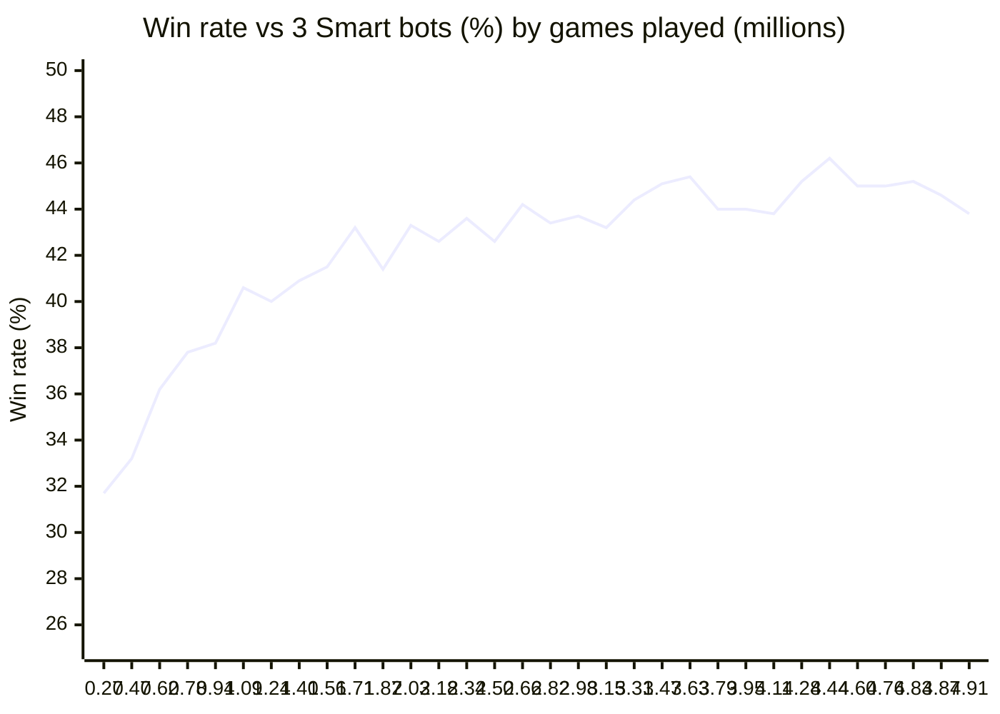
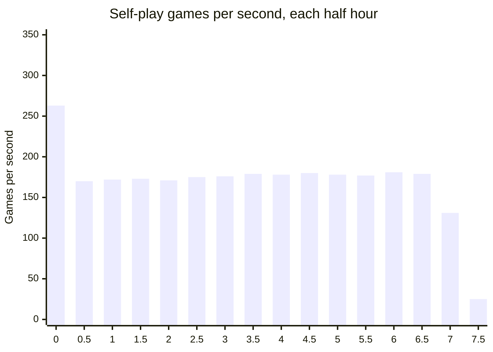

# Training run: selfplay_v1

The run that produced `models/selfplay_v1.pt`. The raw logs are in `docs/training/selfplay-v1/`:

- `train.log`: one line per minute with games played, training steps and loss. The `games/s` column is the average since the start of the run, not the current speed.
- `benchmarks.log`: every saved checkpoint against 3 Smart bots and against 3 copies of the original repo's model (`old`), 2,000 games each. That model was not ported to this repo.

## Setup

| | |
|---|---|
| Machine | MacBook Air 15-inch, M3 (`Mac15,13`), 8 CPU cores (4 performance, 4 efficiency), 16 GB, no fan |
| Software | Python 3.12.2, PyTorch 2.9.1, CPU only |
| Command | `python3 train_selfplay.py --hours 8` (6 actor processes with 1 thread each, learner with 2 threads) |
| Settings | Exploration 1%, Adam with learning rate 3e-4, batch 1,024, examples shuffled in chunks of 16,384, gradient clipping at 1.0, actors refresh weights every 4 games, checkpoint every 15 minutes |
| Network | 716K parameters, started from random weights |
| Benchmarks | Each new checkpoint was benchmarked while training kept running, using 4 more processes |

## Totals

| | |
|---|---|
| Wall time | 8.35 hours (stopped 21 minutes after the 8-hour limit, see below) |
| Games | 4,906,148 |
| Training steps | 215,952 (about 221M examples, about 45 decisions per game) |
| Checkpoints | 32 |
| Chosen | 4,437,010 games, saved at 6.75 hours |

## Learning curve

Win rate as 1 player against 3 copies of the opponent. 25% is break-even, and every result is accurate to about ±2.2%.

| Games | Hours | vs 3 Smart | vs 3 old model |
|---|---|---|---|
| 273,560 | 0.23 | 31.7% | 33.9% |
| 473,727 | 0.48 | 33.2% | 35.9% |
| 623,801 | 0.73 | 36.2% | 36.0% |
| 778,629 | 0.98 | 37.8% | 39.3% |
| 935,234 | 1.24 | 38.2% | 40.7% |
| 1,088,050 | 1.49 | 40.6% | 42.0% |
| 1,243,388 | 1.74 | 40.0% | 41.5% |
| 1,399,436 | 1.99 | 40.9% | 41.2% |
| 1,555,394 | 2.24 | 41.5% | 43.1% |
| 1,712,170 | 2.49 | 43.2% | 43.7% |
| 1,868,473 | 2.74 | 41.4% | 42.0% |
| 2,025,712 | 2.99 | 43.3% | 41.8% |
| 2,184,502 | 3.24 | 42.6% | 42.1% |
| 2,343,235 | 3.49 | 43.6% | 43.8% |
| 2,502,740 | 3.74 | 42.6% | 43.4% |
| 2,662,855 | 3.99 | 44.2% | 43.5% |
| 2,822,835 | 4.24 | 43.4% | 42.7% |
| 2,984,740 | 4.49 | 43.7% | 43.2% |
| 3,145,429 | 4.74 | 43.2% | 42.6% |
| 3,306,017 | 4.99 | 44.4% | 42.4% |
| 3,467,598 | 5.24 | 45.1% | 45.3% |
| 3,628,320 | 5.49 | 45.4% | 44.2% |
| 3,788,650 | 5.74 | 44.0% | 44.9% |
| 3,949,958 | 6.00 | 44.0% | 44.6% |
| 4,113,680 | 6.25 | 43.8% | 45.2% |
| 4,275,509 | 6.50 | 45.2% | 44.2% |
| **4,437,010** | **6.75** | **46.2%** | **44.9%** |
| 4,597,326 | 7.00 | 45.0% | 44.9% |
| 4,757,346 | 7.25 | 45.0% | 46.6% |
| 4,831,392 | 7.50 | 45.2% | 44.5% |
| 4,874,966 | 7.75 | 44.6% | 44.0% |
| 4,906,148 | 8.35 | 43.8% | 44.4% |

Milestones against 3 Smart bots:

| Milestone | First reached |
|---|---|
| Above the paper's Monte Carlo result (32.5%), margin included | 623,801 games, 0.73 hours (36.2%) |
| 40% | 1,088,050 games, 1.49 hours |
| Above the paper's best model, PPO (43.5%) | 2,343,235 games, 3.49 hours (43.6%) |
| 45% | 3,467,598 games, 5.24 hours |

Gains slowed down sharply over the run. The first million games added about 9 points; from 3.5 million games on, every checkpoint landed between 43.8% and 46.2%, which is within the noise of each other.

## Picking the model

The top 3 checkpoints by benchmark were compared head-to-head with `head_to_head.py`. Each game had 2 copies of each model, with the seats shuffled at random. Every deal was played twice with the two models swapped into each other's seats, and each pair played 4,000 games. 50% means equal.

| Matchup | First model's win rate |
|---|---|
| 4.44M vs 4.76M | 50.1% ±1.5% |
| 4.44M vs 4.91M | 50.8% ±1.5% |
| 4.76M vs 4.91M | 50.7% ±1.5% |

None of the three was clearly better. The 4.44M checkpoint was chosen because it scored best against Smart and narrowly won both of its matchups.

Measured later with the shipped file: 55.5% ±2.2% against 3 greedy bots (2,000 games).

## Speed

Games per second for each half hour, worked out from the game counts in `train.log`:

The run had three phases:

1. **First 20 minutes: about 330 games/s.** Close to the 360 games/s of an earlier short test run.
2. **20 minutes to 7 hours: steady at about 175 games/s,** a little over half the starting speed. Training steps dropped by the same ratio, from about 900 to about 460 per minute, so actors and learner slowed down together.
3. **Last hour: down to about 25 games/s.** There's a 26-minute gap in the log starting at 7.92 hours. Because the trainer only checks the time limit between chunks of examples, it overran the 8-hour limit by 21 minutes. Benchmarks of the last checkpoints also took up to 23 times longer than usual. The system load average was about 23 ten minutes after the run ended.

The cause is not confirmed. Phase 2 fits the MacBook Air slowing itself down to stay cool under sustained full load, since it has no fan. Phase 3 points to something else competing for the CPU, or the Mac sleeping. The run used `caffeinate -i`, which stops idle sleep but not sleep from closing the lid.

## Loss

The average loss stayed between 0.33 and 0.35 for the whole run: 0.337 in the first hour, 0.346 in the second, then falling slowly to 0.340 by hour 7. Win rates kept improving while the loss barely moved, which is expected here. The reward depends mostly on the deal and on how the other three players play, and all four seats get stronger together, so the loss is not a useful measure of progress. The benchmarks are.

## For the next run

- Expect about 175 games/s on this Mac under sustained load, not 330, or about 0.6M games per hour.
- Training past about 3.5M games added little with this setup. More games alone are unlikely to help much; changes to the method (a longer move history, PPO) are the next things to try, kept only if they win head-to-head against `selfplay_v1`.
- Keep the lid open and other heavy work off the Mac during a run, and check `pmset -g log` afterwards for sleep events.
